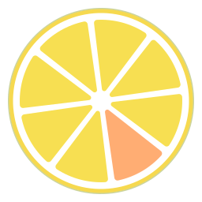

<div align="center">
  
  <h1>柠檬私厨 · LemonSlice Kitchen</h1>
  <p>基于 Halo 的共享点菜与厨房菜单插件。</p>
</div>

由 **RoShioLeo** 为 LemonSlice Cloud 维护的共享点餐与后厨菜单插件。
当前源码版本为 **1.2.0**，插件 ID 为 **`lemonslice-kitchen`**。
项目采用 **GPL-3.0**；上游来源、版权与改造说明见文末及 [NOTICE.md](./NOTICE.md)。

## 共享厨房

- **同一餐一起点菜。** 同一天、同一餐共用共享点菜单，所有人都能看到彼此的昵称和选择。访客默认分配并记住“访客”加四位数字的昵称，可在页面顶部点开修改；已登录的 Halo 用户自动使用账号显示名。
- **自动保存，再提交整单。** 前台调整份数、“本餐备注”和“想吃的其他菜”后自动保存到当前待提交共享单；在共享抽屉点击“提交点餐”，会提交并锁定整张当前共享单，包括大家的选择。提交后只有主厨能修改该批点菜；继续点菜会进入新的待提交加点，再由主厨确认最终菜单。
- **提交前一起调整份数。** 可在共享抽屉直接调整待提交共享单中其他人已点菜品的份数，设为 `0` 会移除；普通参与者不能往别人的点菜里新增菜品或改动其备注。服务端保留原点菜人与修改记录。
- **厨房决定最终菜单。** Halo 超级管理员在「后厨灶台」按餐选择调整点餐记录或最终菜单，一次只编辑一侧，另一侧同步只读；用户的愿望和备注保持只读。份数修改暂存为本地草稿，增加的总量归当前主厨，减少时按来源倒序扣减，`0` 行保留到提交成功。一次原子确认同时写入来源份数、锁定待提交共享单并发布最终菜单；版本冲突时保留草稿，重新载入后再调整。
- **首页只展示已确认菜单。** 早餐、午餐、晚餐纵向排列，只显示有菜品的餐段。没有内容时显示“还没有点餐”；待确认的选择留在共享点菜页，首页保持已确认的菜单快照。
- **菜谱统一管理。** 支持分类、搜索和多标签；同一道菜可指定多个适用餐段，也可添加自定义标签。点菜页按当前餐次匹配菜品，未指定餐段的菜适用于各餐；标签筛选中不重复列出早餐、午餐、晚餐。保留 `1–5` 星推荐等级，不提供“厨师长精选”或随机推荐模块。
- **按餐填写。** 保留“本餐备注”和“想吃的其他菜”，无需逐道填写口味备注。份数控件直接位于菜品行上，未选时只显示加号。

点菜支持**今天及随后 7 天**，日期与默认餐段按 **Asia/Shanghai** 计算。
没有显式选择时，默认 10:00 前为早餐、10:00–14:59 为午餐、15:00 起为晚餐；午餐和晚餐开始时间可在插件设置中调整。
链接指定或手动选择的餐段优先。日期和餐段使用紧凑输入、下拉选择。

共享点菜入口：

```text
/dishes/order?date=2026-11-05&period=lunch
```

`period` 可取 `breakfast`、`lunch`、`dinner`。分享按钮复制当前日期与餐段的链接，
切换日期或餐段时保留草稿，页面保持所选日期和餐段。
共享单提交后，后续加点属于新的待提交批次；已经提交的内容保留，只能由主厨修改。
点菜页可见时每 10 秒同步共享内容，也支持手动刷新；同步保留正在编辑的输入。
桌面与手机均可通过带数量徽标的悬浮入口，打开共享点菜抽屉查看大家的选择、调整待提交菜品的份数。

界面使用柠檬图标、系统无衬线字体、留白、细分隔线和柠檬金，
支持浅色、深色及跟随系统，并与 LemonSlice 博客共用外观选择。
后台保留 Halo 的管理布局与表单习惯。页脚标识为 `LemonSlice Edition`。

新版共享厨房不提供旧版 ZIP 导入导出和企业微信通知入口。
原版说明保留在 [docs/UPSTREAM_README.md](./docs/UPSTREAM_README.md)，
新版规则与接口见 [共享厨房契约](./docs/KITCHEN-REDESIGN-API.md)，
修改记录见 [CHANGELOG.md](./CHANGELOG.md)。

## 安装与升级

要求 **Halo >= 2.23.0**，运行环境使用对应 Halo 支持的 Java 版本。

1. 从 [Releases](https://github.com/RoShioLeo/halo-plugin-dishes/releases) 下载对应版本的 JAR，或按下方步骤构建。当前源码版本为 `1.2.0`。
2. 在 Halo 后台「插件」上传并启用“柠檬私厨”；已安装同 ID 插件时使用升级操作。
3. 在「菜品管理」创建分类、菜品和标签，在「插件设置」调整图标、文案、访问模式等。
4. 默认前台地址为 `/dishes`；超级管理员通过「后厨灶台」查看点菜并确认菜单。

插件 ID 为 **`lemonslice-kitchen`**，公开地址继续使用 `/dishes`。
从旧 ID `dishes` 切换时，先停用旧插件，再启用本插件；保留旧插件安装以便回退，不要同时启用两者。
1.2 沿用 1.1 的共享点菜与确认菜单数据模型和接口，接续现有设置、菜谱与点餐记录；不导入原项目旧数据模型或小数份数。
上游 Halo 应用市场提供的是原版；本修改版以本仓库的源码和发布包为准。

可选共享访问密码沿用插件的家庭访问方式；厨师操作由服务端校验 Halo
超级管理员权限，公开点菜不会授予厨房管理权限。

## 从源码构建

使用 **JDK 21、Node.js 24、pnpm 10.12.4** 和仓库自带的 Gradle wrapper。
两个前端均保留依赖锁文件。

```sh
corepack enable
corepack prepare pnpm@10.12.4 --activate
./gradlew --no-daemon clean build
```

Windows 使用 `gradlew.bat --no-daemon clean build`。
产物：`build/libs/lemonslice-kitchen-1.2.0.jar`。

Gradle 构建同时执行 Java 测试、Console 的 Vitest 交互测试、公开前台的 Node 测试，
以及两个前端的 TypeScript 检查和 Vite 打包。

公开前台单独开发：

```sh
pnpm --dir web-frontend install --frozen-lockfile
pnpm --dir web-frontend dev
```

开发代理默认指向 `http://127.0.0.1:8090`；嵌入 Halo 时由插件注入前台路由 base。
上游独立部署说明保留在[原作者部署文档](https://avrinbai.cn/docs/dishes/)。

## 许可与来源

原作者 **bai**：[avrinbai.cn](https://avrinbai.cn)。
上游仓库：[Avrinbai/halo-plugin-dishes](https://github.com/Avrinbai/halo-plugin-dishes)。
初始改造基线：上游 `1.0.3` / `ddb7a9f524323bf7efd3da90d056af369d04f071`，由 RoShioLeo 自 2026-11-05 开始维护。

本修改版继续按 [GNU GPL-3.0](./LICENSE) 发布，不附带担保。
发布版本提供对应 Git tag 和完整源码包，版权及修改说明见 [NOTICE.md](./NOTICE.md)。
JAR 附带 `META-INF/LICENSE`、`META-INF/NOTICE.md`、`META-INF/CHANGELOG.md`，
以及[第三方许可清单](./THIRD_PARTY_NOTICES.md)和完整第三方许可文本。
